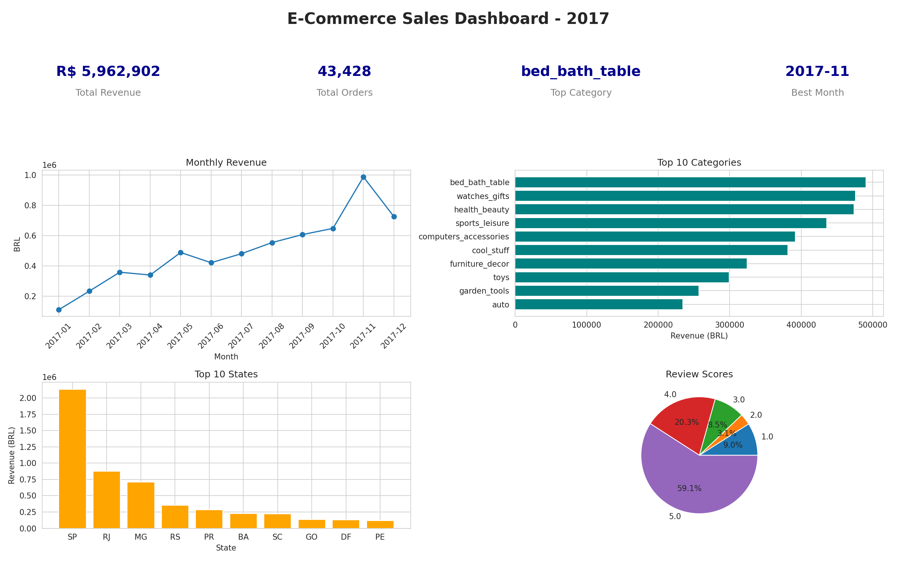

# E-Commerce Sales Analysis (Olist Brazil, 2017)

An end-to-end data analysis of 2017 sales for a Brazilian e-commerce marketplace. The project cleans and merges raw order data, answers five business questions, builds six visualisations and a one-page management dashboard, and ends with five data-backed business recommendations.

> Completed as part of the Pluto Academy Data Analytics Internship (Project 01).

---

## Problem Statement

As a data analyst at an e-commerce company, analyse 12 months of sales data to:

- Understand performance and identify trends
- Compare product categories and regions
- Build a dashboard a manager can read at a glance
- Recommend actions based on the findings

## Dataset

- **Source:** [Brazilian E-Commerce Public Dataset by Olist (Kaggle)](https://www.kaggle.com/datasets/olistbr/brazilian-ecommerce)
- **Files used:** orders, order items, products, customers, order reviews, and the category name translation table
- **Scope of analysis:** delivered orders placed in calendar year 2017 (43,428 orders)

## Tools and Libraries

| Tool | Purpose |
|---|---|
| Python | Core analysis |
| Pandas, NumPy | Data cleaning, merging, aggregation |
| Matplotlib, Seaborn | Visualisations and dashboard |
| Google Colab | Development environment |
| GitHub | Version control and portfolio hosting |

## Data Cleaning Steps

1. Checked all tables for missing values and duplicate rows.
2. Converted order date columns to datetime format.
3. Removed duplicate rows from the orders and order items tables.
4. Kept only the latest review for orders with more than one review.
5. Filled missing product categories with `unknown`.
6. Kept only orders with status `delivered`, since cancelled or unavailable orders do not generate revenue.
7. Merged items, orders, products, category translations, and customers into one analysis table.
8. Filtered to full-year 2017 to get a clean 12-month window.
9. Built a separate order-level table for order value and review analysis, so a review is not counted multiple times.

## Business Questions Answered

1. Which product category has the highest revenue?
2. Which month had peak sales?
3. Which region (state) performs best?
4. What is the average order value trend?
5. What is the customer review score distribution?

## Dashboard



**Headline KPIs**

| Total Revenue | Total Orders | Top Category | Best Month |
|---|---|---|---|
| $ 5,962,902 | 43,428 | bed_bath_table | 2017-11 |

## Visualisations

1. Bar chart: top 10 categories by revenue
2. Line chart: monthly revenue trend
3. Bar chart: top 10 states by revenue
4. Histogram: distribution of order values
5. Pie chart: review score distribution
6. Heatmap: revenue by category and month

## Key Findings

- **Diversified categories:** `bed_bath_table` leads with $ 490,597 (8.2% of revenue), but the top three categories are within $ 17,000 of each other, so no single category dominates.
- **Strong November peak:** Revenue grew from $ 111,798 in January to $ 987,765 in November (about 8.8x), then fell 26% in December.
- **Regional concentration:** São Paulo alone contributes 35.8% of revenue. SP, RJ, and MG together account for about 62%.
- **Growth from volume, not basket size:** Average order value stayed between $ 124 and $ 149 all year (overall $ 137.31).
- **High satisfaction with a problem area:** The average review score is 4.17 / 5, but 1-star reviews (9.0%) are nearly three times as common as 2-star reviews (3.1%).

## Business Recommendations

1. Prioritise stock and marketing for the top five categories and test promotions in mid-ranked ones.
2. Prepare inventory, logistics, and ad budgets before October to handle the November surge.
3. Protect the SP, RJ, and MG markets while piloting campaigns in RS, PR, and BA to reduce regional dependence.
4. Introduce a free-shipping threshold (about R$ 150 to 170) and bundle offers to raise average order value.
5. Investigate 1-star reviews by delivery time, category, and seller, and fix the main cause first.

The full written report is in the notebook under **"4. Business Insights Report"**.

## Repository Structure

```
ecommerce-sales-analysis/
├── Olist_Sales_Analysis.ipynb   # Full analysis notebook (cleaning, analysis, charts, report)
├── dashboard.png                # One-page sales dashboard
└── README.md                    # Project documentation
```

## How to Run

1. Download the dataset from [Kaggle](https://www.kaggle.com/datasets/olistbr/brazilian-ecommerce) and unzip it.
2. Open `Olist_Sales_Analysis.ipynb` in [Google Colab](https://colab.research.google.com).
3. Upload the dataset zip file (or update the file paths in the notebook).
4. Run all cells with **Runtime → Run all**.

## Limitations

- The analysis covers delivered orders from 2017 only, so results may differ for other years or order statuses.
- The November peak is likely linked to Black Friday and holiday shopping, but the dataset does not confirm the cause.
- Revenue is calculated from item price and excludes freight charges.

## Author

**[Jay Jadhav]**
[GitHub](https://github.com/jayjadhav33)
